<div align="center">


**Modern game server management. Built for performance.**

[](./LICENSE.md)
[](https://github.com/brocker96/raptor-panel/stargazers)
[](https://github.com/brocker96/raptor-panel/issues)

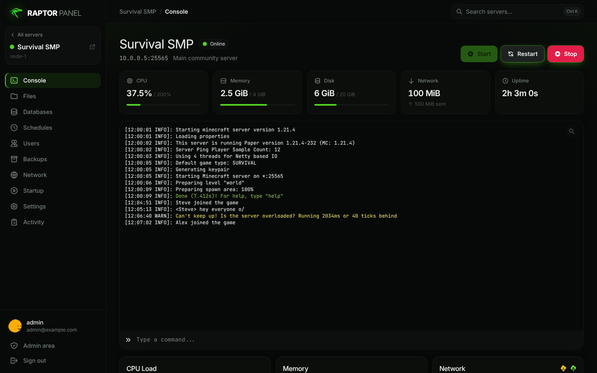

</div>

---

## 🚀 Quick install

One command on a **clean Ubuntu 24.04 LTS** server (run as root):

```bash
bash <(curl -fsSL https://raw.githubusercontent.com/brocker96/raptor-panel/0.x_beta/install.sh)
```

The installer asks a few questions (domain, email, admin password, whether to install Wings) and then sets up
PHP 8.3, MariaDB, Redis, nginx, the queue worker, cron, a Let's Encrypt certificate and — optionally — Docker +
Wings on the same machine, registered as the first node with ready-to-use allocations. Budget VPS with < 2 GB RAM
get a swap file automatically for the front-end build. Credentials end up in `/root/raptor-credentials.txt`.

Fully unattended:

```bash
curl -fsSL https://raw.githubusercontent.com/brocker96/raptor-panel/0.x_beta/install.sh -o install.sh
RAPTOR_FQDN=panel.example.com RAPTOR_EMAIL=me@example.com RAPTOR_WINGS=yes RAPTOR_YES=1 bash install.sh
```

All options are documented at the top of [`install.sh`](install.sh).

## ⚡ Raptor vs. upstream — measured, not promised

| | Pterodactyl 1.x | Raptor Panel |
|---|---|---|
| Front-end build | 31 s (webpack) | **10 s** (Vite 8 / Rolldown) |
| JS for the dashboard | 1.7 MiB | **0.77 MiB** |
| SQL queries for the server list (50/page) | 340 | **15** |
| `GET /api/client` | 191 ms | **39 ms** |
| Activity page on a 175k-entry log | 551 ms | **0.5 ms** |
| Directory with 5,000 files | capped at 250 | **all of them**, ~18 DOM rows |
| 3,000-line console burst | one write per line | **one batched write per frame** |
| Dashboard polling | every card, even in background tabs | **only visible cards, tab in foreground** |
| WebSocket reconnect | fixed 1 s retry, stale token | **backoff + jitter, fresh token** |
| Phone support | desktop UI squeezed | **bottom navigation, mobile editor** |

<table>
<tr>
<td>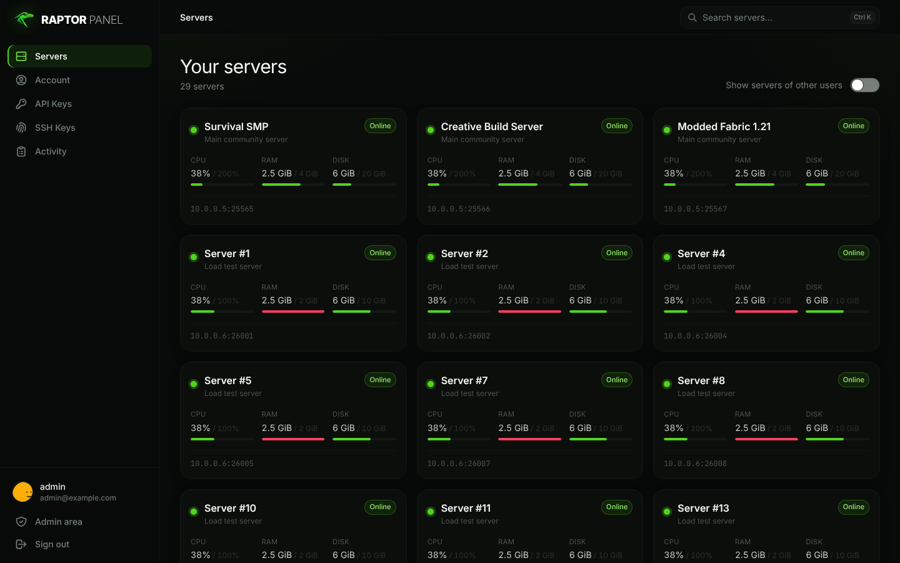</td>
<td>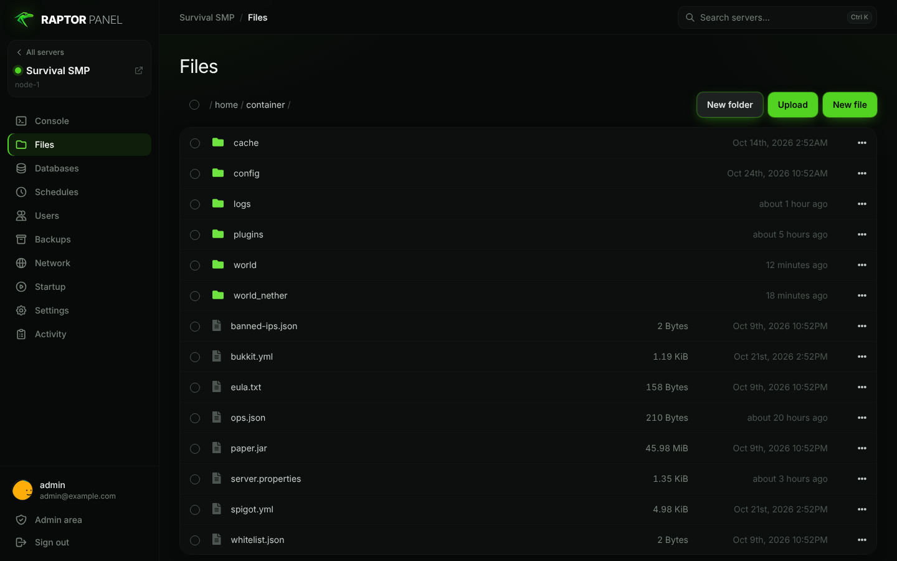</td>
</tr>
<tr>
<td>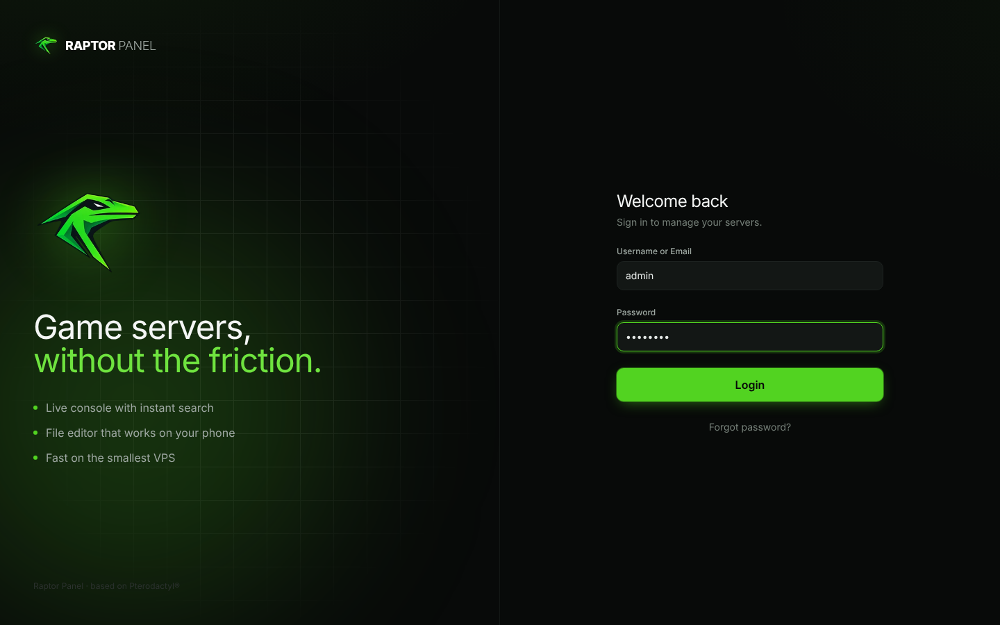</td>
<td align="center">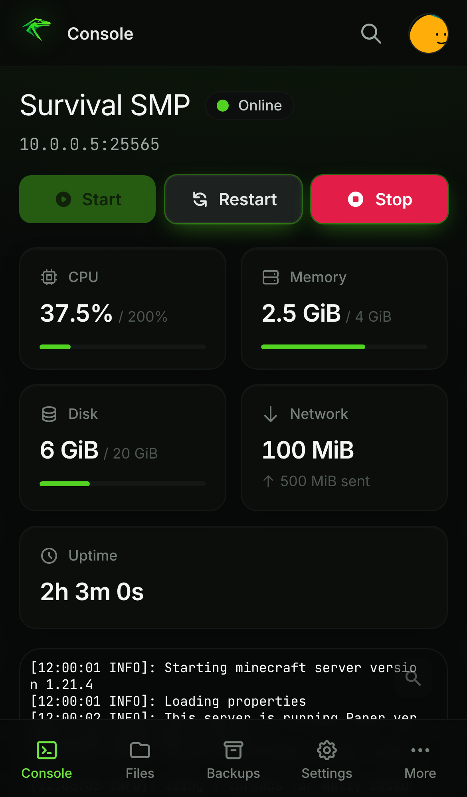 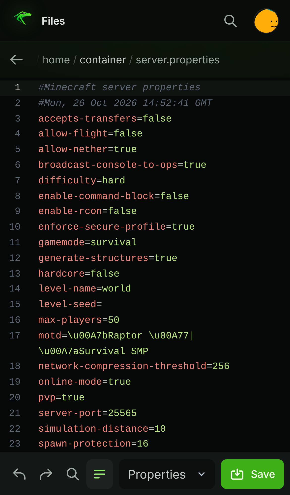</td>
</tr>
</table>

## 🛡️ Admin area, rebuilt in React

The whole admin area is a fast React app with animations, live node status and **29 built-in step-by-step guides** —
every page has a **Guide** button that explains each field, with tips, warnings and FAQ.

- **Overview** — counts, server health, node capacity, 14-day activity chart, health checks.
- **Servers** — search by name / owner / IP / port, five-step creation wizard, build, startup, databases, mounts,
  reinstall, suspend, transfer, delete.
- **Nodes** — live Wings status & latency, config.yml + one-click auto-deploy, bulk allocations with inline aliases.
- **Nests & eggs** — full egg editor with CodeMirror, variables with rule presets, install scripts, import / export.
- **Users, locations, database hosts, mounts, API keys** (permission matrix + IP allow-list).
- **Audit log** for the whole Panel, **System** page with health checks, failed jobs (retry / forget) and cache tools.
- **Settings → Cloudflare** — trusted proxies, console keepalive, refreshable IP ranges and a per-node DNS / port check.

The original Blade admin is still available at `/admin/legacy`.

<table>
<tr>
<td>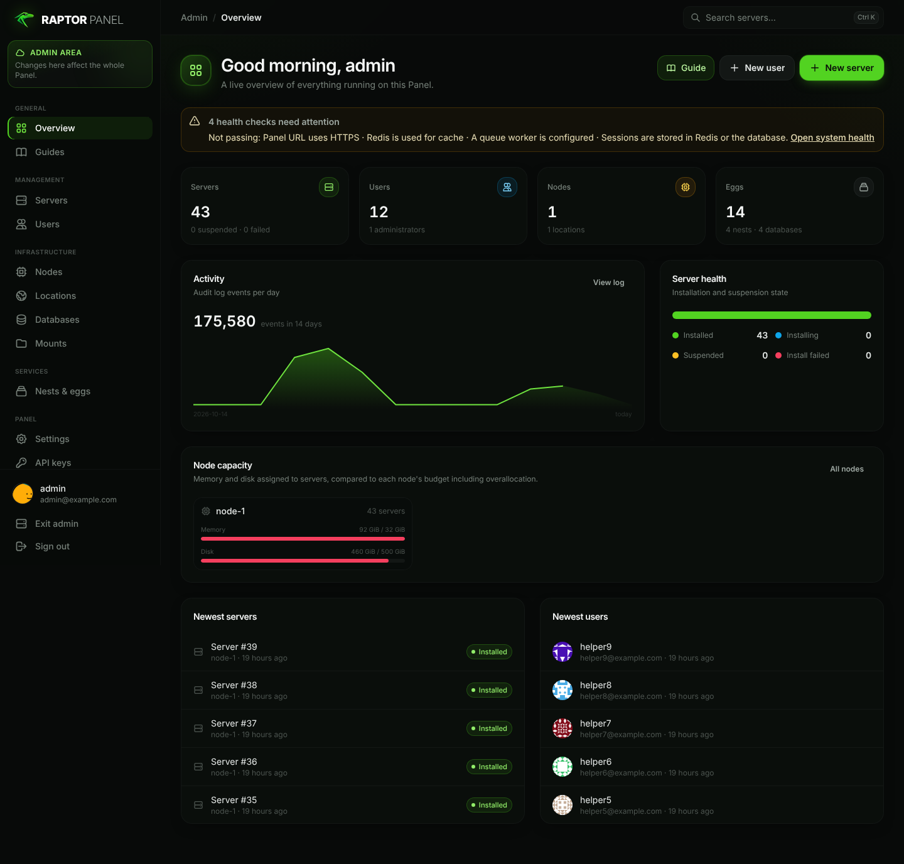</td>
<td>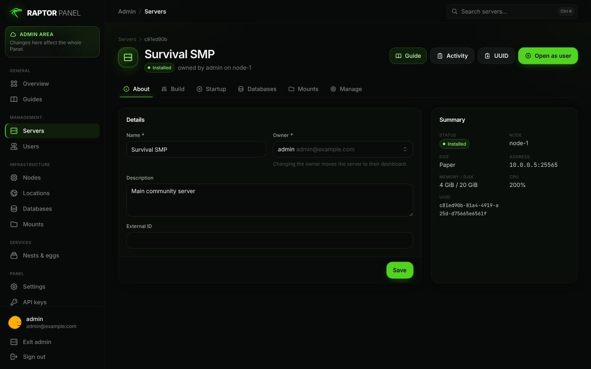</td>
</tr>
<tr>
<td>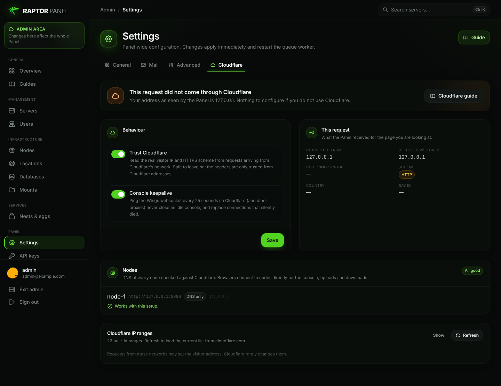</td>
<td>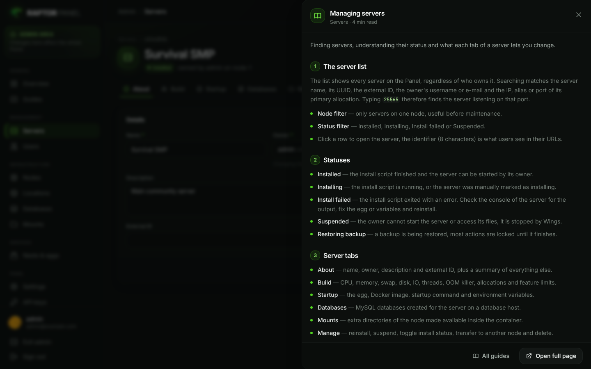</td>
</tr>
</table>

## 🧱 Stack

React 18 · TypeScript · Vite 8 · TanStack Query · React Router 7 · CodeMirror 6 · xterm.js 5 · Tailwind CSS · Laravel 12 · PHP 8.2+

## 🦖 About Raptor Panel

**Raptor Panel** is a free and open-source server management panel built upon the foundation of [Pterodactyl](https://github.com/pterodactyl/panel).

The project aims to improve the server management experience through a modern interface, performance optimizations, improved usability, and additional functionality.

Raptor Panel is designed with a simple philosophy:

**Powerful server management shouldn't come at the cost of performance or usability.**

Our goal is to build a clean, efficient, and flexible platform that makes managing servers easier for everyone.

Raptor Panel is an independent community project and is not officially affiliated with the Pterodactyl development team.

## ✨ Project Goals

Raptor Panel is being developed with several key priorities in mind.

### 🎨 Modern Interface

A redesigned user interface focused on:

- Clean and consistent design.
- Intuitive navigation.
- Responsive layouts.
- Improved accessibility.
- A better experience across desktop and mobile devices.

### ⚡ Performance

Performance is one of the project's primary development goals.

Planned improvements include:

- Reduced frontend overhead.
- Optimized API interactions.
- Improved resource efficiency.
- Faster and smoother navigation.
- Reduced unnecessary rendering and network requests.

### 🛠️ Enhanced Functionality

Raptor Panel aims to improve existing functionality while introducing new capabilities.

Development will focus on:

- Server management.
- File management.
- Console usability.
- Resource monitoring.
- Administrative tools.
- Quality-of-life improvements.

### 🔐 Security & Reliability

Security and stability remain essential priorities.

The project aims to preserve the security principles of Pterodactyl while improving maintainability, reliability, and the overall development experience.

---

## 🚧 Development Status

> [!IMPORTANT]
> **Raptor Panel is currently in early development.**
>
> The project is based on Pterodactyl's `1.0-develop` branch.
>
> Major changes, improvements, and new features are planned. The current codebase may still closely resemble the original Raptor Panel.
>
> Raptor Panel is not yet recommended for production environments.

Development is ongoing, and additional information will be added as the project evolves.

## 🗺️ Roadmap

The following roadmap outlines the initial development direction.

| Area | Description | Status |
|---|---|---|
| Branding | Establish Raptor Panel's visual identity | 🚧 In Progress |
| UI/UX | Redesign the user interface | 📋 Planned |
| Performance | Optimize frontend and backend performance | 📋 Planned |
| File Manager | Improve file management experience | 📋 Planned |
| Console | Enhance the server console | 📋 Planned |
| Monitoring | Improve resource monitoring and visualization | 📋 Planned |
| Administration | Refine administrative tools | 📋 Planned |
| Documentation | Create dedicated Raptor Panel documentation | 📋 Planned |

This roadmap is subject to change as development progresses.

---

## 🏗️ Technology

Raptor Panel builds upon Pterodactyl's existing architecture.

The original project uses:

- **PHP / Laravel** — Backend application.
- **React / TypeScript** — Frontend interface.
- **Go** — Wings server daemon.
- **Docker** — Containerized server environments.
- **MySQL / MariaDB** — Database storage.
- **Redis** — Caching and queue management.

The technology stack may evolve as Raptor Panel develops.

## 🎮 Supported Games & Applications

Raptor Panel inherits Pterodactyl's container-based server management architecture.

Through Pterodactyl's Egg system, the underlying platform supports a wide range of games and applications, including:

- Minecraft
- Terraria
- Rust
- Garry's Mod
- ARK: Survival Evolved
- Team Fortress 2
- Factorio
- TeamSpeak
- Mumble
- Node.js applications
- Python applications
- Discord bots

Additional configurations are available through the [Pterodactyl Eggs repository](https://github.com/pterodactyl/eggs).

Compatibility with existing Eggs and integrations will be evaluated throughout development.

---

## 📖 Documentation

Dedicated Raptor Panel documentation is planned.

Until then, the original Pterodactyl documentation may be useful for understanding the underlying architecture.

- [Pterodactyl Documentation](https://pterodactyl.io/)
- [Raptor Panel Installation](https://pterodactyl.io/panel/1.0/getting_started.html)
- [Wings Documentation](https://pterodactyl.io/wings/1.0/installing.html)
- [Pterodactyl GitHub](https://github.com/pterodactyl/panel)

> [!NOTE]
> Instructions from the original Pterodactyl documentation may not apply to future versions of Raptor Panel.

## 🤝 Contributing

Raptor Panel is an open-source project, and contributions are welcome.

Whether you're interested in improving performance, refining the interface, fixing bugs, or suggesting new features, your involvement is appreciated.

You can contribute by:

- Reporting bugs.
- Suggesting improvements.
- Submitting pull requests.
- Reviewing code.
- Improving documentation.

Please open an issue before starting major architectural changes to discuss the proposed implementation.

## 💬 Feedback & Suggestions

Have an idea for Raptor Panel?

Feel free to [open an issue](https://github.com/brocker96/raptor-panel/issues) to share your feedback, report a problem, or suggest a new feature.

Community feedback is valuable in shaping the future of the project.

---

## ❤️ Acknowledgements

Raptor Panel is built upon the work of the **Pterodactyl Project** and its contributors.

We sincerely appreciate the time, effort, and dedication that went into creating and maintaining the original project.

Without Pterodactyl and its open-source community, Raptor Panel would not exist.

- [Pterodactyl Website](https://pterodactyl.io/)
- [Pterodactyl GitHub Repository](https://github.com/pterodactyl/panel)

## 📜 License

Raptor Panel is based on Raptor Panel, which is distributed under the MIT License.

Original Pterodactyl copyright:

**Copyright © 2015–2022 Dane Everitt and contributors.**

Raptor Panel modifications:

**Copyright © 2026 Raptor Panel contributors.**

The software is distributed under the terms of the [MIT License](./LICENSE.md).

Original copyright notices and applicable license terms are retained in accordance with the MIT License.

---

<div align="center">

### 🦖 Raptor Panel

**Server management, refined.**

Built on Pterodactyl. Driven by open source.

[GitHub](https://github.com/brocker96/raptor-panel) · [Report a Bug](https://github.com/brocker96/raptor-panel/issues) · [Contribute](https://github.com/brocker96/raptor-panel/pulls)

</div>
